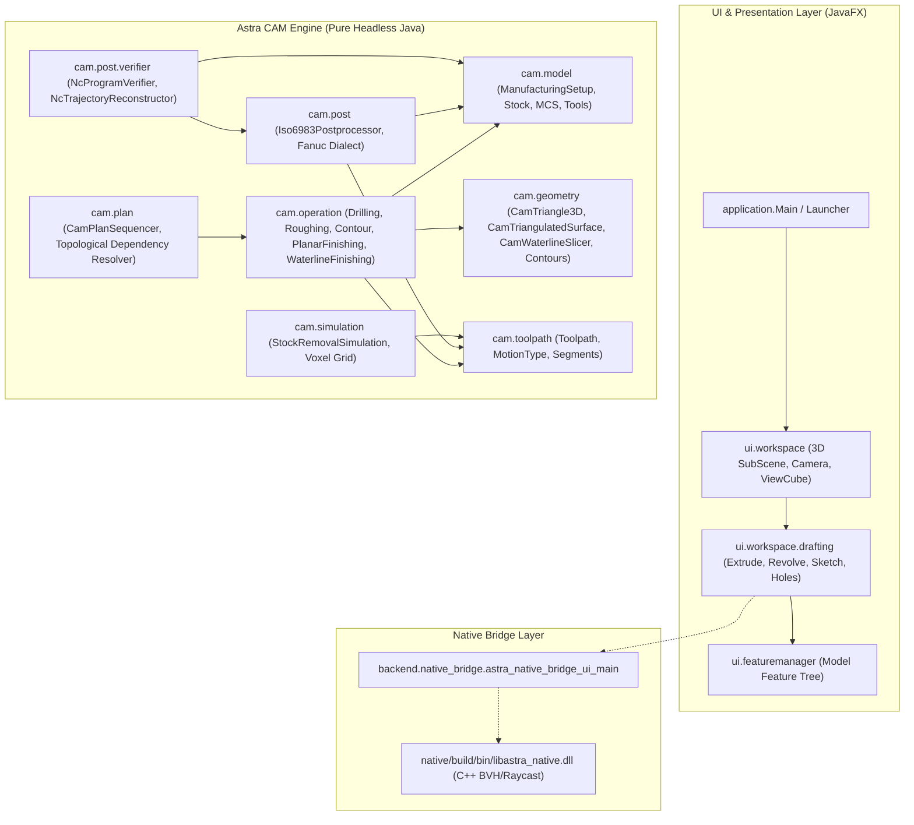

# Astra / MultiPhysics: Comprehensive Project Handoff Report
**Authoritative Architectural Blueprint, Verification Evidence, and Development Roadmap**

- **Repository**: `E:\MultiPhysics`
- **Branch**: `main`
- **Latest Verified Checkpoint**: `7a76731` (`feat(milestone-9.1): add bounded 3d waterline finishing`)
- **Date**: 2026-10-28
- **Master Regression Status**: **24 Test Suites, 1,370 Direct Assertions, 0 Failures**
- **Safety Qualification**: Verified Software Geometric & Controller Contracts; Physical CNC Machining Safety Non-Certified

---

## 1. Project Identity & Purpose

**Astra / MultiPhysics** is an integrated CAD/CAM platform developed for mechanical modeling, geometric analysis, and automated CNC manufacturing. It combines:
1. **Interactive Desktop CAD**: A JavaFX 3D parametric CAD modeler supporting sketches, basic primitives, CSG booleans, extrusions, revolves, lofts, sweeps, holes, and view manipulation.
2. **Native Performance Acceleration**: An optional C++ native acceleration bridge (`astra_native.dll`) providing vectorized Ray-Cast and Bounding Volume Hierarchy (BVH) algorithms for large mesh queries.
3. **Astra CAM (Computer-Aided Manufacturing)**: A pure-Java, headless, fail-closed CAM engine that generates, plans, postprocesses, and verifies 3-axis CNC machining operations from CAD solid and surface geometry.

Target workflows:
- Rapid parametric component design and feature tree management.
- Multi-operation CAM process planning (Facing, Roughing, Holemaking, 2D Contouring, 3D Parallel Planar Finishing, and 3D Waterline Finishing).
- Preflight ISO 6983 G-code trajectory reconstruction, fixture collision auditing, and conservative stock-removal simulation.

---

## 2. Project Status Summary

| Area | Current State | Evidence / Metrics |
| :--- | :--- | :--- |
| **Git Working Tree** | Clean; `main` branch synced with `origin/main` | Latest commit `7a76731` |
| **Active Checkpoint** | Milestone 9.1 Complete | `feat(milestone-9.1): add bounded 3d waterline finishing` |
| **Build Configuration** | Frozen `pom.xml` strictly preserved | SHA-256: `DEEA003B51DD0A6145657727FC85153913F273B8FEC8B840F65A240BC7EF6309` |
| **Production Files** | 315 `.java` files in `src/main/java/` | **100% $\le 200$ physical lines per file** |
| **Headless CAM Rule** | Zero UI/JavaFX imports in `cam/**` | Strict adherence verified via source scan |
| **Preserved Native Toolchain** | `src/main/CPP/` untouched and untracked | Preserved in repository, excluded from handoff ZIP |
| **CAM Regression Battery** | **24 Test Suites Passing** | **1,370 Direct Assertions, 0 Failures** |

---

## 3. Architecture Overview

### 3.1 Layered Architecture Diagram



### 3.2 Directory Structure & Package Responsibilities

- `src/main/java/application/`: Desktop application entry points, JavaFX launch coordinator, and top-level error handling.
- `src/main/java/ui/`: JavaFX modular UI components (Feature Manager, Workspace 3D SubScene, ViewCube navigation, Breadcrumb bar, Toolbars, Menus).
- `src/main/java/ui/workspace/drafting/`: CAD modeling algorithms (Extrude, Revolve, Shell, Loft, Sweep, Machining, Holes, Topology, Sketching).
- `src/main/java/backend/native_bridge/`: JNI interface delegating high-throughput polygon intersection and raycasting to native code.
- `src/main/java/cam/`: Pure headless CAM package:
  - `model/`: Domain data structures: [`ManufacturingSetup`](file:///E:/MultiPhysics/src/main/java/cam/model/ManufacturingSetup.java), [`StockDimensions`](file:///E:/MultiPhysics/src/main/java/cam/model/StockDimensions.java), [`MachineCoordinateSystem`](file:///E:/MultiPhysics/src/main/java/cam/model/MachineCoordinateSystem.java), [`SafetyPlane`](file:///E:/MultiPhysics/src/main/java/cam/model/SafetyPlane.java).
  - `geometry/`: 2D/3D CAM geometry: [`CamTriangle3D`](file:///E:/MultiPhysics/src/main/java/cam/geometry/CamTriangle3D.java), [`CamTriangulatedSurface`](file:///E:/MultiPhysics/src/main/java/cam/geometry/CamTriangulatedSurface.java), [`CamWaterlineSlicer`](file:///E:/MultiPhysics/src/main/java/cam/geometry/CamWaterlineSlicer.java), [`CamContour2D`](file:///E:/MultiPhysics/src/main/java/cam/geometry/CamContour2D.java), [`CamContourOffsetEngine`](file:///E:/MultiPhysics/src/main/java/cam/geometry/CamContourOffsetEngine.java), [`CamLeadEngine`](file:///E:/MultiPhysics/src/main/java/cam/geometry/CamLeadEngine.java).
  - `operation/`: Machining strategies: [`SpotDrillingOperation`](file:///E:/MultiPhysics/src/main/java/cam/operation/SpotDrillingOperation.java), [`DeepHoleDrillingOperation`](file:///E:/MultiPhysics/src/main/java/cam/operation/DeepHoleDrillingOperation.java), [`PrismaticRoughingOperation`](file:///E:/MultiPhysics/src/main/java/cam/operation/PrismaticRoughingOperation.java), [`ContourFinishingOperation`](file:///E:/MultiPhysics/src/main/java/cam/operation/ContourFinishingOperation.java), [`ParallelPlanarFinishingOperation`](file:///E:/MultiPhysics/src/main/java/cam/operation/ParallelPlanarFinishingOperation.java), [`WaterlineFinishingOperation`](file:///E:/MultiPhysics/src/main/java/cam/operation/WaterlineFinishingOperation.java).
  - `plan/`: Multi-operation planning: [`CamOperationPlan`](file:///E:/MultiPhysics/src/main/java/cam/plan/CamOperationPlan.java), [`CamPlanSequencer`](file:///E:/MultiPhysics/src/main/java/cam/plan/CamPlanSequencer.java), [`CamPlanExecutor`](file:///E:/MultiPhysics/src/main/java/cam/plan/CamPlanExecutor.java).
  - `post/`: CNC postprocessing: [`Iso6983Postprocessor`](file:///E:/MultiPhysics/src/main/java/cam/post/Iso6983Postprocessor.java), [`ControllerProfile`](file:///E:/MultiPhysics/src/main/java/cam/post/ControllerProfile.java).
  - `post/verifier/`: Preflight validation: [`NcProgramVerifier`](file:///E:/MultiPhysics/src/main/java/cam/post/verifier/NcProgramVerifier.java), [`NcTrajectoryReconstructor`](file:///E:/MultiPhysics/src/main/java/cam/post/verifier/NcTrajectoryReconstructor.java).
  - `simulation/`: Material removal simulation: [`StockRemovalSimulation`](file:///E:/MultiPhysics/src/main/java/cam/simulation/StockRemovalSimulation.java).
- `src/main/resources/`: Application icons, theme styling CSS (`light.css`, `dark.css`).
- `native/`: C++ clean source and test harness (`astra_native.h`, `astra_native.cpp`, `test_native_main.cpp`).
- `docs/reports/`: Full historical record of engineering milestones and independent audit reports.

---

## 4. Development & Milestone History

| Milestone | Commit | Description | Assertion Count |
| :--- | :---: | :--- | :---: |
| **M1** | `f416809` | Extrude recovery, defects DEF-01 to DEF-06, solid identity validation | 150+ |
| **M2** | `c18f894` | Headless CAM foundation, ManufacturingSetup, tool models, spot drilling | 60 |
| **M3** | `42eb7df` | Deep-hole peck drilling (G83/G73), peck retract strategies, safety validator | 12 |
| **M4** | `bf8288b` | 2.5D prismatic roughing, stepover, stepdown, zig-zag rastering | 27 |
| **M5** | `0c4fb55` | Headless stock-removal simulation, 3D voxel grid analyzer, volume metrics | 28 |
| **M6–M6.4** | `5538495`–`0d6ed9e` | ISO 6983 Fanuc 3-axis postprocessor, adversarial G-code audit, verifier | 202 |
| **M7** | `9cbb453` | CAM operation planning, dependency graph, topological DAG sequencer | 52 |
| **M8.1–M8.4**| `398253e`–`6dd3b03` | 2D contour geometry, miter joins, tangential/circular lead-in/out | 264 |
| **M8.5–M8.7**| `5ceace3`–`3b7da1c` | NC contract audit, independent trajectory oracle, rounded motion checks | 397 |
| **M8.8–M8.11**| `fc3be36`–`bad9c05`| Controller semantics, G53/G54/G92 frames, Euclidean swept fixture collision | 175 |
| **M9.0** | `a913568` | Bounded 3D parallel planar finishing, CamTriangle3D, CamTriangulatedSurface | 35 |
| **M9.0.1** | `6e55a06`–`29ef493`| Cutter-disk chord intersections, V-groove bridging, residual stock math | 32 |
| **M9.0.2** | `bbb5d2e` | Independent 20k-sample numerical oracle, tangent contacts, swept cylinder | 36 |
| **M9.1** | `7a76731` | **Bounded 3D waterline (Z-level) finishing, slicer, loop assembly, NC gate** | **50** |
| **TOTAL** | — | **Astra CAM Complete Regression Battery (24 Suites)** | **1,370** |

---

## 5. Current Feature Inventory

### 5.1 Fully Implemented & Test-Verified
- **Axial Holemaking**: Spot drilling and G83 deep-hole peck drilling with exact depth termination.
- **2.5D Roughing**: Prismatic pocket roughing with bounded stepover, axial stepdown, and floor limits.
- **2D Profile Finishing**: Contour finishing with inside/outside offsetting, miter joins, and circular lead transitions.
- **3D Parallel Planar Finishing**: Directional raster passes over arbitrary triangulated surfaces with cutter-disk compensation ($Z_{\text{tool}} = \sup_{(u,v)\in\mathcal{D}} Z(u,v)$), chord intersection detection, and safe rapid linking.
- **3D Waterline (Z-Level) Finishing**: Constant-Z slicing, closed-loop and open-chain reconstruction, collinear vertex reduction, tool radius compensation, and safe multi-level linking.
- **CAM Process Sequencing**: Directed Acyclic Graph (DAG) dependency solver with cycle detection.
- **NC Postprocessing & Verification**: ISO 6983 Fanuc-compatible dialect, coordinate frame tracking, G98/G99 canned cycle semantics, and Euclidean swept cylinder collision checks.
- **Stock Removal Simulation**: Voxel grid representation tracking remaining volume and swept tool envelope.

### 5.2 Partially Implemented & Integration Gaps
- **CAD-to-CAM Pipeline**: CAD solid meshes must currently be manually converted to `CamTriangulatedSurface` instances for CAM operations; automated UI-driven feature-to-operation binding is not yet complete.
- **CAM Toolpath Viewport Visualization**: Generated `Toolpath` objects are verified numerically and in postprocessed G-code, but are not yet rendered in the JavaFX 3D `workspace_ui_main` SubScene.
- **Ball-Endmill 3D Surface Contact**: Waterline and planar finishing operations currently focus on flat endmills. Ball endmills with 3D normal vector contact compensation are architecturally isolated and deferred.

---

## 6. Build & Environment Instructions

### 6.1 Prerequisites
- **JDK**: Microsoft Build of OpenJDK 25 (version `25.0.4.101-hotspot` or standard JDK 25).
- **Maven**: Version 3.8+ (using project's frozen `pom.xml`).
- **Operating System**: Windows (PowerShell environment).

### 6.2 Key Verification Commands
```powershell
# Set Java environment
$env:JAVA_HOME = "C:\Program Files\Microsoft\jdk-25.0.4.101-hotspot"
$env:PATH = "$env:JAVA_HOME\bin;$env:PATH"

# 1. Compile pure headless CAM engine
javac -d target/classes (Get-ChildItem -Path src/main/java/cam -Recurse -Filter *.java | ForEach-Object { $_.FullName })

# 2. Run master CAM regression battery (24 suites)
powershell -ExecutionPolicy Bypass -File E:\MultiPhysics_Supporting_Files\scratch\run_all_cam_regression_battery.ps1

# 3. Audit all test assertions and exit codes
powershell -ExecutionPolicy Bypass -File E:\MultiPhysics_Supporting_Files\scratch\audit_all_cam_suites_assertions.ps1

# 4. Verify frozen POM SHA-256 hash
Get-FileHash -Path pom.xml -Algorithm SHA256

# 5. Audit 200-line limit across all production Java files
Get-ChildItem -Path src/main/java -Recurse -Filter *.java | Where-Object { (Get-Content $_.FullName).Length -gt 200 }
```

---

## 7. Non-Negotiable Development Constraints

1. **Frozen `pom.xml`**:
   Must NEVER be edited. Required SHA-256:
   `DEEA003B51DD0A6145657727FC85153913F273B8FEC8B840F65A240BC7EF6309`
2. **200-Line Limit**:
   Every production file under `src/main/java/` must remain $\le 200$ physical lines. Break up complex logic into helper classes or delegates.
3. **Headless CAM**:
   Package `cam/**` must NEVER import `javafx.*` or UI packages.
4. **Preserve `src/main/CPP/`**:
   The `src/main/CPP/` directory contains large prebuilt native binaries and must remain untouched, uncommitted, and EXCLUDED from any handoff ZIP archives.
5. **Fail-Closed Verification**:
   All safety checks (boundaries, collisions, non-finite values) must fail closed (raise an exception or return non-approved status).
6. **Push Verification**:
   Never assume `git push` succeeded without checking exit code and remote output.

---

## 8. Recommended Roadmap for Future Work

1. **Milestone 9.2: Ball-Endmill 3D Surface Profiling**:
   Extend `CamTriangulatedSurface` and `WaterlineFinishingOperation` with ball-endmill compensation ($Z_{\text{ball}} = Z(\mathbf{p}) + R(1 - n_z)$).
2. **Milestone 9.3: CAM Toolpath Viewport Rendering**:
   Create a dedicated JavaFX 3D group rendering toolpath motion segments (cyan for feeds, yellow for rapids, red for plunges) directly in `workspace_ui_main`.
3. **Milestone 10: Automatic CAD Feature Machining**:
   Integrate CAD feature tree (holes, pockets, bosses) directly with `CamPlanSequencer` to automatically generate candidate manufacturing plans.
