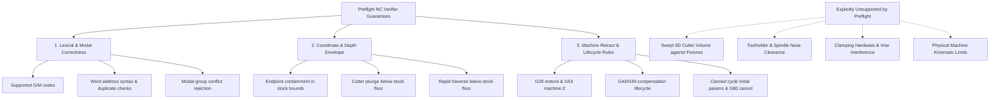

# Astra / MultiPhysics — Milestone 6.4: NC Verification Contract Review

**Date:** 2026-10-27  
**Commit Target:** `test(milestone-6.4): audit NC verifier controller semantics and safety contracts`  
**Repository:** `E:\MultiPhysics`  
**Branch:** `main`  
**Status:** COMPLETE & VERIFIED

---

## 1. Executive Summary & Verification Scope

Milestone 6.4 conducts an independent audit of the NC preflight verification contract built across Milestones 6.1–6.3 before proceeding to **Milestone 7: CAM Operation Planning and Sequencing**.

The audit scrutinized controller semantics, NC dialect modeling, G-code parameter inheritance, modal return levels, and numerical bounds. A dedicated test suite ([`TestMilestone64ContractReview.java`](file:///E:/MultiPhysics_Supporting_Files/scratch/TestMilestone64ContractReview.java)) comprising **34 new assertions** was developed and executed, bringing the cumulative verified assertion count across all production CAD and CAM test suites to **854 assertions** (0 failures).

---

## 2. Audited Controller Semantics & Dialect Assumptions

### A. G28 Reference Point Return vs G53 Machine Coordinates
The audit confirmed distinct modeling for intermediate reference returns (`G28`) versus machine-coordinate positioning (`G53`):
* **`G53` (Machine Coordinates)**:
  * Non-modal single-block override referencing machine absolute coordinates.
  * Target $Z$ coordinate is validated strictly against the configured machine retract coordinate (`profile.getMachineRetractZ()`). Mismatches trigger `RETRACT_TARGET_INVALID`.
  * If commanded while a canned cycle is active, flags `RETRACT_DURING_CYCLE`.
* **`G28` (Reference Point Return)**:
  * Models reference point return through an intermediate position.
  * In standard Fanuc/ISO practice, commonly emitted as `G91 G28 Z0.` to return $Z$ to machine home without intermediate axis travel.
  * If issued while in incremental mode (`G91`), the verifier marks `referenceReturnPendingRestore = true`.
  * **Contract Enforcement**: If subsequent cutting or rapid motion is commanded before restoring absolute mode via `G90`, the verifier rejects the program with `RETRACT_MODE_NOT_RESTORED`.
  * **Safe Termination**: If `G91 G28 Z0.` is executed immediately prior to program termination (`M30`), it is approved as standard machine parking without false alarms.
  * If commanded during an active canned cycle, flags `RETRACT_DURING_CYCLE`.

### B. Absolute / Incremental Distance Mode Policy (`G90` / `G91`)
* Under the standard `ControllerProfile.CoordinateMode.ABSOLUTE_G90`:
  * Rapid positioning (`G00`) and retracts (`G91 G28 Z0.`) in `G91` are tracked incrementally and verified for stock clearance without drift.
  * Any cutting feed motion (`G01`) commanded while in incremental distance mode (`G91`) is rejected with `UNEXPECTED_INCREMENTAL_MODE`.

### C. Canned Cycles: Parameter Inheritance, Return Levels & Cancellation
* **Fail-Closed Initial Parameter Enforcement**:
  * An initial canned cycle definition (`G81`, `G83`, `G73`) omitting $R$-plane or final $Z$-depth fails closed and is rejected with `CANNED_CYCLE_INVALID_PARAMS`.
  * Peck drilling cycles (`G83`, `G73`) missing positive $Q$ increments fail closed with `CANNED_CYCLE_INVALID_PARAMS`.
* **Modal Parameter Inheritance**:
  * $R$ and $Z$ parameters established on the initial cycle block are retained modally in [`NcInterpreterState`](file:///e:/MultiPhysics/src/main/java/cam/post/verifier/NcInterpreterState.java).
  * Subsequent coordinate blocks (`X... Y...`) execute hole cycles at the inherited $R$ plane and $Z$ depth.
  * An in-cycle coordinate block specifying a new $Z$ depth updates the modal cycle depth for that hole and all subsequent holes.
  * Inverted depths ($Z_{\text{depth}} \ge R_{\text{plane}}$) trigger `CANNED_CYCLE_INVERTED_DEPTH`.
  * Sub-surface $R$-planes ($R < Z_{\text{stock top}}$) trigger `CANNED_CYCLE_SUB_SURFACE_R`.
  * Cycle depth penetrating below stock floor ($Z < Z_{\text{stock bottom}}$) triggers `STOCK_DEPTH_VIOLATION`.
* **Return Levels (`G98` / `G99`)**:
  * Return to initial level (`G98`) is modeled as the default return mode.
  * Return to $R$-plane (`G99`) is modeled and tracked in modal state.
  * Conflicting modal return commands in a single block (`G98 G99`) are rejected with `CONFLICTING_MODAL_COMMANDS`.
* **Cancellation & State Clearing**:
  * `G80`, `G00`, or `G01` explicitly cancels canned cycle mode and clears modal cycle $R$ and $Z$ parameters.
  * Programs terminating (`M30` / `M02`) while a cycle remains active are rejected with `CANNED_CYCLE_NOT_CANCELLED`.

### D. Tool Length Compensation Lifecycle (`G43` / `G49`)
* Tool changes (`T... M06`) reset active compensation state.
* Cutting motion without active compensation triggers `TOOL_LENGTH_COMP_MISSING`.
* `G43` activation height is checked against stock top; activation inside stock triggers `UNSAFE_COMPENSATION_POSITION`.
* Tool length offset register mismatch ($H \ne H_{\text{expected}}$) triggers `TOOL_OFFSET_MISMATCH`.
* Tool changes or program end (`M30`) without prior `G49` cancellation trigger `TOOL_LENGTH_NOT_CANCELLED`.
* Tool change attempted during active canned cycle triggers `TOOL_CHANGE_DURING_CYCLE`.

---

## 3. Confirmed Defects & Fixes

During adversarial probing, the following two defects were identified and fixed:

| # | Component | Defect | Root Cause | Resolution |
|---|---|---|---|---|
| 1 | [`NcProgramVerifier.java`](file:///e:/MultiPhysics/src/main/java/cam/post/verifier/NcProgramVerifier.java) | In-cycle $Z$-depth updates ignored | Repeated cycle block filter only matched `(hasWord('X') \|\| hasWord('Y'))`, ignoring blocks updating $Z$ | Updated filter to `(p.hasWord('X') \|\| p.hasWord('Y') \|\| p.hasWord('Z'))` to properly inherit and update modal cycle parameters |
| 2 | [`NcBlockParser.java`](file:///e:/MultiPhysics/src/main/java/cam/post/verifier/NcBlockParser.java) | Missing conflict detection for return levels & spindle codes | `checkConflictingModalCommands` only checked Groups 1, 3, 2 | Added checks for `G98` vs `G99` (Group 10 return modes) and `M03` vs `M05` (spindle start vs stop) |

---

## 4. Separation of Verification Guarantees

The verifier strictly delineates what is verified versus what cannot be verified without complete 3D solid models:

Every verification report explicitly emits an `INFO` diagnostic ([`UNSUPPORTED_COLLISION_CHECK`](file:///e:/MultiPhysics/src/main/java/cam/post/verifier/NcFindingCode.java)):
> *"Preflight checks audit endpoints and stock boundaries. Swept 3D cutter volume, holder, and fixture checks require complete 3D solid models."*

---

## 5. Physical Machine Safety Notice

> [!WARNING]
> **Passing automated NC verifier tests does NOT guarantee physical machine safety.**
> Preflight software verification verifies mathematical, syntactic, and configured bounding rules. It cannot substitute for:
> 1. Physical machine setup validation and work coordinate probing (WCS zero offset).
> 2. Real-world tool length measurement, gauge-length calibration, and runout checks.
> 3. Visual dry-run above workpiece clearance with single-block execution and feed hold override active.
> 4. Physical verification of clamps, fixtures, vises, and spindle housing clearances.

---

## 6. Verification & Test Execution Results

All required verification scripts and compilers completed with 100% pass rates:

| Suite / Check | Assertions | Result | Status |
|---|---|---|---|
| `mvn compile` | Full workspace build | BUILD SUCCESS | Pass |
| [`run_test_milestone64_contract_review.ps1`](file:///E:/MultiPhysics_Supporting_Files/scratch/run_test_milestone64_contract_review.ps1) | 34 | 34 passed, 0 failed | Pass |
| [`run_test_milestone63_adversarial_audit.ps1`](file:///E:/MultiPhysics_Supporting_Files/scratch/run_test_milestone63_adversarial_audit.ps1) | 42 | 42 passed, 0 failed | Pass |
| [`run_test_milestone62_verification.ps1`](file:///E:/MultiPhysics_Supporting_Files/scratch/run_test_milestone62_verification.ps1) | 58 | 58 passed, 0 failed | Pass |
| [`run_test_milestone6_postprocessor.ps1`](file:///E:/MultiPhysics_Supporting_Files/scratch/run_test_milestone6_postprocessor.ps1) | 68 | 68 passed, 0 failed | Pass |
| [`run_test_milestone5_simulation.ps1`](file:///E:/MultiPhysics_Supporting_Files/scratch/run_test_milestone5_simulation.ps1) | 28 | 28 passed, 0 failed | Pass |
| [`run_test_milestone4_roughing.ps1`](file:///E:/MultiPhysics_Supporting_Files/scratch/run_test_milestone4_roughing.ps1) | 27 | 27 passed, 0 failed | Pass |
| [`run_test_cam_foundation.ps1`](file:///E:/MultiPhysics_Supporting_Files/scratch/run_test_cam_foundation.ps1) | 60 | 60 passed, 0 failed | Pass |
| [`run_prod_test_suites.ps1`](file:///E:/MultiPhysics_Supporting_Files/scratch/run_prod_test_suites.ps1) | 537 | 537 passed, 0 failed | Pass |
| **Cumulative Assertions** | **854** | **854 passed, 0 failed** | **Pass** |
| `verify_line_counts.ps1` | 291 files | 0 files over 200 lines | Pass |
| `pom.xml` SHA-256 Hash | `DEEA003B51DD...` | Exact match | Pass |
| `git diff --check` | Clean diff | 0 errors | Pass |

### Exact Line Counts for Modified Files
* [`NcProgramVerifier.java`](file:///e:/MultiPhysics/src/main/java/cam/post/verifier/NcProgramVerifier.java): **195 lines** ($\le 200$)
* [`NcMotionVerifier.java`](file:///e:/MultiPhysics/src/main/java/cam/post/verifier/NcMotionVerifier.java): **156 lines** ($\le 200$)
* [`NcInterpreterState.java`](file:///e:/MultiPhysics/src/main/java/cam/post/verifier/NcInterpreterState.java): **141 lines** ($\le 200$)
* [`NcBlockParser.java`](file:///e:/MultiPhysics/src/main/java/cam/post/verifier/NcBlockParser.java): **134 lines** ($\le 200$)

---

## 7. Next Step: Milestone 7

With Milestone 6.4 completed and preflight safety verification contracts audited, the pipeline is ready for **Milestone 7: CAM Operation Planning and Sequencing**—unifying setup validation, operation dependencies, tool selection, stock simulation, NC postprocessing, and deterministic preflight verification into one automated end-to-end workflow.
