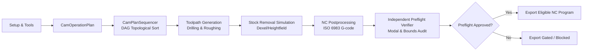

# Astra / MultiPhysics — Milestone 7: CAM Operation Planning and Sequencing Report

**Date:** 2026-10-27  
**Commit Target:** `feat(milestone-7): add deterministic CAM operation planning and sequencing`  
**Repository:** `E:\MultiPhysics`  
**Branch:** `main`  
**Status:** COMPLETE & VERIFIED

---

## 1. Executive Summary & Objective

Milestone 7 establishes a deterministic, pure-Java, headless CAM operation-planning layer that connects all existing Astra CAM subsystem capabilities into a unified, traceable, and validated workflow:

Prior milestones implemented isolated capabilities:
* **Milestones 2–3**: CAM foundation, tool definitions, spot drilling, and deep-hole peck drilling.
* **Milestone 4**: 2.5D prismatic pocket roughing with inward offsetting and swept cutter containment.
* **Milestone 5**: Discrete stock-removal simulation with residual uncut island and boundary gouge analysis.
* **Milestones 6.1–6.4**: Controller-configurable NC postprocessing, independent preflight verifier, adversarial audits, and controller contract review.

Milestone 7 unites these capabilities into an integrated orchestration layer without adding speculative or unverified machine kinematic features.

---

## 2. Architecture & Public APIs

The planning layer is encapsulated in package [`cam.plan`](file:///e:/MultiPhysics/src/main/java/cam/plan/):

### Core Classes & Responsibilities

| Class | Source File | Lines | Responsibility |
|---|---|---|---|
| [`CamPlannedOperation`](file:///e:/MultiPhysics/src/main/java/cam/plan/CamPlannedOperation.java) | `src/main/java/cam/plan/CamPlannedOperation.java` | 60 | Models an individual planned operation with unique identity, display name, operation type, tool reference, underlying executable delegate (`CamOperation`), and explicit dependencies (`Set<String>`). |
| [`CamOperationPlan`](file:///e:/MultiPhysics/src/main/java/cam/plan/CamOperationPlan.java) | `src/main/java/cam/plan/CamOperationPlan.java` | 64 | Aggregates a `ManufacturingSetup`, target `ControllerProfile`, and an ordered collection of `CamPlannedOperation` definitions. |
| [`CamPlanValidationResult`](file:///e:/MultiPhysics/src/main/java/cam/plan/CamPlanValidationResult.java) | `src/main/java/cam/plan/CamPlanValidationResult.java` | 55 | Structured validation output recording validity (`boolean valid`), error diagnostics, warnings, and resolved execution sequence. |
| [`CamPlanSequencer`](file:///e:/MultiPhysics/src/main/java/cam/plan/CamPlanSequencer.java) | `src/main/java/cam/plan/CamPlanSequencer.java` | 99 | Dependency-aware topological sort algorithm using Kahn's algorithm with stable tie-breaking, self-dependency rejection, missing dependency detection, and explicit cycle diagnostics. |
| [`CamPlanExecutionStatus`](file:///e:/MultiPhysics/src/main/java/cam/plan/CamPlanExecutionStatus.java) | `src/main/java/cam/plan/CamPlanExecutionStatus.java` | 26 | Explicit terminal and stage states: `NOT_STARTED`, `VALIDATION_FAILED`, `EXECUTION_FAILED`, `SIMULATION_FAILED`, `NC_GENERATION_FAILED`, `PREFLIGHT_FAILED`, `COMPLETED_WITH_WARNINGS`, `COMPLETED`. |
| [`CamPlanExecutionResult`](file:///e:/MultiPhysics/src/main/java/cam/plan/CamPlanExecutionResult.java) | `src/main/java/cam/plan/CamPlanExecutionResult.java` | 84 | Immutable output container capturing execution status, ordered toolpaths (`Map<String, Toolpath>`), simulated stock grid (`StockRemovalGrid`), generated G-code (`NcProgram`), NC verification report (`NcVerificationReport`), and export gating logic. |
| [`CamPlanExecutor`](file:///e:/MultiPhysics/src/main/java/cam/plan/CamPlanExecutor.java) | `src/main/java/cam/plan/CamPlanExecutor.java` | 133 | Orchestration pipeline executing validation, DAG sequencing, toolpath dispatching, stock simulation, NC postprocessing, preflight verification, and safe file export. |

---

## 3. Plan Validation & Deterministic Scheduling Rules

### Plan Validation
Before dispatching any toolpath computation, the executor validates:
1. **Setup & Stock Integrity**: Non-null `ManufacturingSetup`, non-null `StockDimensions`, non-null `MachineCoordinateSystem`, and non-null `ControllerProfile`.
2. **Operation Syntax & Uniqueness**: Every operation must possess a non-blank ID. Duplicate IDs within a plan are rejected with `Duplicate operation ID '...'`.
3. **Dependency Integrity**:
   * **Self-Dependencies**: Rejected with `Self-dependency detected: Operation '...' cannot depend on itself.`
   * **Missing Dependencies**: Referenced dependency IDs not present in the plan are rejected with `Missing dependency: Operation '...' depends on unknown operation '...'`.
   * **Cycle Detection**: Cyclic dependency loops (e.g. $A \to B \to C \to A$) are identified and rejected with `Dependency cycle detected involving operations: [...]`.
4. **Supported Operation Types**:
   * **Supported**: `SPOT_DRILLING`, `DEEP_HOLE_DRILLING`, `PRISMATIC_ROUGHING`.
   * **Unsupported**: `CONTOUR_FINISHING`, `FACING` are rejected with `unsupported operation type` diagnostics until dedicated operational engines are implemented in subsequent milestones.
5. **Operation-Specific Geometric Constraints**: Each operation's internal `validate(setup)` method is invoked to check hole containment, flute lengths, tool tip angles, stepover limits, and stock depths.

### Deterministic Scheduling Algorithm
* The topological sort constructs an in-degree map and dependency adjacency graph.
* When multiple operations are independent (in-degree == 0), tie-breaking strictly follows the **natural declaration order** of operations within `CamOperationPlan`.
* The sequencing algorithm is bit-deterministic: running identical plans produces the exact same execution order across runs without variation.

---

## 4. Execution Pipeline & Failure Gating

The execution pipeline processes through sequential stages, halting immediately if a required stage fails:

1. **Stage 1: Validation**: If validation fails, execution terminates immediately with `VALIDATION_FAILED`. No toolpaths, simulation, or NC programs are generated.
2. **Stage 2: Toolpath Generation**: Dispatches operations in topological order. If an operation produces an empty/null toolpath or throws, execution terminates with `EXECUTION_FAILED`.
3. **Stage 3: Stock Simulation**: Applies each generated toolpath and tool geometry to `StockRemovalGrid`. If an error occurs, terminates with `SIMULATION_FAILED`.
4. **Stage 4: NC Postprocessing**: Aggregates operations in resolved sequence and invokes `Iso6983Postprocessor`. If postprocessing throws, terminates with `NC_GENERATION_FAILED`.
5. **Stage 5: Preflight NC Verification**: Runs `NcProgramVerifier` against the generated G-code stream.
   * If preflight discovers blocking errors: status is set to `PREFLIGHT_FAILED`, and `isExportEligible()` returns `false`.
   * If preflight passes with warnings: status is `COMPLETED_WITH_WARNINGS`, and `isExportEligible()` returns `true`.
   * If preflight passes cleanly: status is `COMPLETED`, and `isExportEligible()` returns `true`.
6. **Safe Export Gating**:
   * Calling `exportNc(Path destination, boolean overwrite)` strictly asserts `isExportEligible()`. If blocking errors exist, it throws `IllegalStateException`.
   * If the target file exists and `overwrite == false`, it throws `FileAlreadyExistsException` to prevent accidental overwrites.

---

## 5. Physical Machine Safety Notice

> [!WARNING]
> **Preflight software verification and plan sequencing do not guarantee physical machine safety.**
> Automated plan execution verifies lexical G-code syntax, modal states, configured stock boundaries, and toolpath continuity. Software verification cannot inspect physical workpiece clamping, raw stock mounting accuracy, machine table limits, or tool wear. Physical machine setup validation, work coordinate system zeroing, and a dry-run above workpiece clearance with single-block execution active are mandatory before cutting on physical machinery.

---

## 6. Verification & Test Execution Results

All test suites were independently compiled and verified with 100% pass rates:

| Test Suite / Inspection | Command / Script | Assertions | Status |
|---|---|---|---|
| **Milestone 7 CAM Operation Planning** | [`run_test_milestone7_planning.ps1`](file:///E:/MultiPhysics_Supporting_Files/scratch/run_test_milestone7_planning.ps1) | 52 | **52 passed, 0 failed** |
| Milestone 6.4 NC Contract Review | [`run_test_milestone64_contract_review.ps1`](file:///E:/MultiPhysics_Supporting_Files/scratch/run_test_milestone64_contract_review.ps1) | 34 | **34 passed, 0 failed** |
| Milestone 6.3 Adversarial Audit | [`run_test_milestone63_adversarial_audit.ps1`](file:///E:/MultiPhysics_Supporting_Files/scratch/run_test_milestone63_adversarial_audit.ps1) | 42 | **42 passed, 0 failed** |
| Milestone 6.2 NC Verification | [`run_test_milestone62_verification.ps1`](file:///E:/MultiPhysics_Supporting_Files/scratch/run_test_milestone62_verification.ps1) | 58 | **58 passed, 0 failed** |
| Milestone 6.1 NC Postprocessor | [`run_test_milestone6_postprocessor.ps1`](file:///E:/MultiPhysics_Supporting_Files/scratch/run_test_milestone6_postprocessor.ps1) | 68 | **68 passed, 0 failed** |
| Milestone 5 Stock Simulation | [`run_test_milestone5_simulation.ps1`](file:///E:/MultiPhysics_Supporting_Files/scratch/run_test_milestone5_simulation.ps1) | 28 | **28 passed, 0 failed** |
| Milestone 4 Prismatic Roughing | [`run_test_milestone4_roughing.ps1`](file:///E:/MultiPhysics_Supporting_Files/scratch/run_test_milestone4_roughing.ps1) | 27 | **27 passed, 0 failed** |
| Milestone 2/3 CAM Foundation | [`run_test_cam_foundation.ps1`](file:///E:/MultiPhysics_Supporting_Files/scratch/run_test_cam_foundation.ps1) | 60 | **60 passed, 0 failed** |
| Production CAD Gate Suites | [`run_prod_test_suites.ps1`](file:///E:/MultiPhysics_Supporting_Files/scratch/run_prod_test_suites.ps1) | 537 | **537 passed, 0 failed** |
| **Cumulative Verified Assertions** | | **906** | **906 passed, 0 failed** |
| Full Maven Compilation | `mvn compile` (JDK 25) | 298 source files | **BUILD SUCCESS** |
| Production Source Line Limits | `verify_line_counts.ps1` | 298 files | **0 files > 200 lines** |
| Frozen `pom.xml` Hash | `Get-FileHash pom.xml` | `DEEA003B...` | **Exact match** |
| Git Whitespace Audit | `git diff --check` | Clean working tree | **0 errors** |

### Production Java File Line Count Audit
All 7 newly authored classes in `cam.plan` satisfy the $\le 200$ physical lines constraint:
* [`CamPlanExecutor.java`](file:///e:/MultiPhysics/src/main/java/cam/plan/CamPlanExecutor.java): **133 lines**
* [`CamPlanSequencer.java`](file:///e:/MultiPhysics/src/main/java/cam/plan/CamPlanSequencer.java): **99 lines**
* [`CamPlanExecutionResult.java`](file:///e:/MultiPhysics/src/main/java/cam/plan/CamPlanExecutionResult.java): **84 lines**
* [`CamOperationPlan.java`](file:///e:/MultiPhysics/src/main/java/cam/plan/CamOperationPlan.java): **64 lines**
* [`CamPlannedOperation.java`](file:///e:/MultiPhysics/src/main/java/cam/plan/CamPlannedOperation.java): **60 lines**
* [`CamPlanValidationResult.java`](file:///e:/MultiPhysics/src/main/java/cam/plan/CamPlanValidationResult.java): **55 lines**
* [`CamPlanExecutionStatus.java`](file:///e:/MultiPhysics/src/main/java/cam/plan/CamPlanExecutionStatus.java): **26 lines**

---

## 7. Known Limitations & Next Recommended Milestones

### Intentional Milestone Boundaries
1. **Tool Change Minimization & Optimization**: The sequencer strictly honors explicit DAG dependencies and declaration order. It does not reorder operations across dependency barriers to minimize tool changes (deferred to a dedicated optimization milestone).
2. **Finishing & Facing Operations**: `CONTOUR_FINISHING` and `FACING` are formally declared in `CamOperationType` but fail closed during plan validation as unsupported until their respective toolpath generators are completed.
3. **3D Collision Verification**: As with earlier milestones, preflight verification checks toolpaths against stock bounding boxes and bottom depth planes. Swept-volume toolholder, spindle, and clamping fixture collision checking require full 3D solid assembly models.
